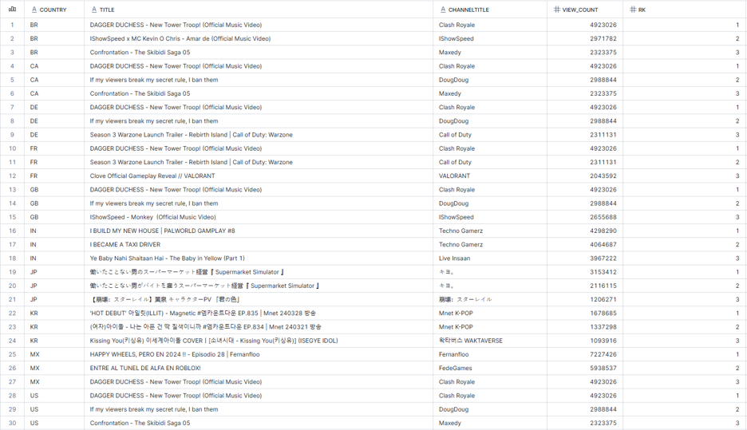
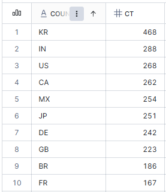
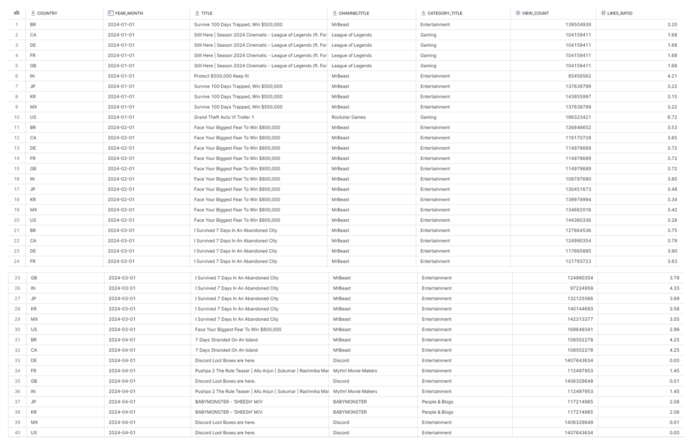
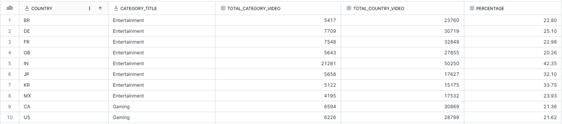
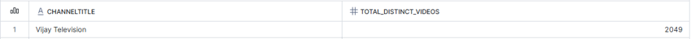
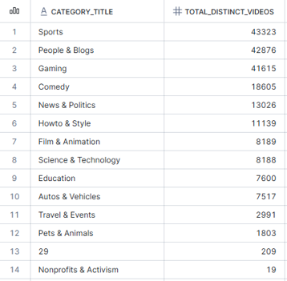
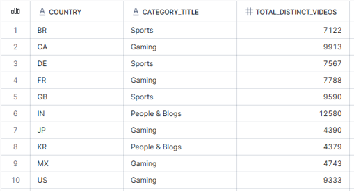

# YouTube Trending — Data & Business Analysis

This document presents the results of **Part 3 (Data Analysis)** and **Part 4 (Business Analysis)** of the YouTube Trending Data Engineering & Analytics project. The analysis uses the cleaned Snowflake dataset of **2,597,494 records** across **10 countries**. Screenshots of query results can be added to the `images/` folder using the filenames referenced below.

## Part 3 — Data Analysis

Five SQL analyses explored the geographical distribution of trending content, video views, relative likes, category representation, and channel visibility.

### 3.1 Top Three Gaming Videos by Country

**Objective:** Identify the three Gaming videos with the highest `view_count` in each country on **1 April 2024**.

**Finding:** *DAGGER DUCHESS - New Tower Troop! (Official Music Video)* appeared in the top three in **seven countries** and ranked first in **Brazil, Canada, Germany, France, Great Britain, and the United States**. Different videos led in other markets, illustrating both shared and country-specific trends.

**Snowflake query results**

### 3.2 Geographic Distribution of BTS-Related Videos

**Objective:** Count distinct trending videos with **“BTS”** in their titles, by country, using a case-insensitive search.

**Finding:** South Korea recorded **468** distinct videos, followed by India (**288**) and the United States (**268**); France recorded **167**. BTS-related titles appeared across markets, but their representation differed.

**Snowflake query results**

### 3.3 Monthly Most-Viewed Videos and Likes Ratio

**Objective:** For each country and month in **2024**, identify the highest-viewed video and calculate `likes_ratio = likes / view_count × 100`, truncated to two decimal places.

**Finding:** View count and relative likes capture different aspects of performance. In **April 2024**, the US monthly leader had approximately **1.41 billion views** and a displayed **0.00%** likes ratio, while Canada's leader had approximately **108.5 million views** and a **4.25%** likes ratio. A displayed 0.00% reflects truncation, not necessarily zero likes.

**Snowflake query results**

### 3.4 Dominant Video Category by Country

**Objective:** Using records dated **1 January 2022 onward**, find the category with the highest number of distinct videos in each country and its percentage of that country's distinct videos.

**Finding:** **Entertainment** led in **eight of ten countries**, while **Gaming** led in **Canada and the United States**. Entertainment represented **42.35%** of India's distinct videos, demonstrating variation in leading-category share across markets.

**Snowflake query results**

### 3.5 Channel with the Highest Number of Distinct Videos

**Objective:** Identify the channel associated with the greatest number of distinct trending videos.

**Finding:** **Vijay Television** had **2,049 distinct videos** in the dataset. This measures representation by distinct videos, not the highest total views or engagement.

**Snowflake query results**

---

## Part 4 — Business Analysis

### Business Question

**Which video category offers the strongest starting point for a new YouTube channel, excluding Music and Entertainment, and should the same category strategy be applied across countries?**

The analysis uses **historical trending representation**, rather than claiming to predict whether a newly published video will trend.

### 4.1 Overall Category Representation

**Approach:** Exclude **Music** and **Entertainment**, then count distinct `video_id` values by category across the dataset.

| Category | Distinct trending videos |
|---|---:|
| **Sports** | **43,323** |
| People & Blogs | 42,876 |
| Gaming | 41,615 |

**Finding:** Sports had the highest overall representation, although the three leading categories were relatively close in count.

**Snowflake query results**

### 4.2 Leading Categories by Country

**Approach:** Identify the category with the highest number of distinct trending videos in each country, again excluding Music and Entertainment.

| Leading category | Countries | Number of countries |
|---|---|---:|
| **Gaming** | Canada, France, Japan, Mexico, United States | **5** |
| Sports | Brazil, Germany, Great Britain | 3 |
| People & Blogs | India, South Korea | 2 |

**Finding:** Although Sports led overall, **Gaming** led in five countries and **People & Blogs** led in two, showing that the global leader was not the leader in every market.

**Snowflake query results**

### 4.3 Business Recommendation

If a target country has not been specified, **Sports** is the strongest starting category based on overall historical trending representation among the eligible categories. For a defined target market, however, the results support a **country-specific content strategy**: Gaming is historically more represented in Canada, France, Japan, Mexico, and the United States; Sports in Brazil, Germany, and Great Britain; and People & Blogs in India and South Korea.

**Limitation:** Historical category counts do not establish that choosing a category will cause a new video or channel to trend. Content quality, timing, existing audience, and engagement may also matter.

---

*Source: Snowflake SQL analysis documented in `part_3.sql` and `part_4.sql`.*
