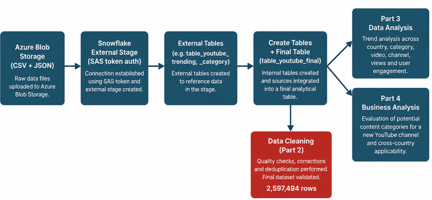

# YouTube Trending Data Lakehouse & Analytics

**Azure Blob Storage | Snowflake | SQL | Data Engineering | Business Analytics**

## Project Overview

This project develops an end-to-end, cloud-based data engineering and analytics pipeline to explore YouTube trending video patterns across **10 countries**. Raw CSV and JSON files were stored in **Microsoft Azure Blob Storage**, accessed and transformed using **Snowflake**, and integrated into a unified analytical dataset for SQL-based analysis.

The project also addresses a business question: **Which video category has the strongest historical representation in trending lists for a new YouTube channel, and does the same category strategy apply across countries?**

## Tech Stack

- **Cloud storage:** Microsoft Azure Blob Storage
- **Data platform:** Snowflake
- **Language:** SQL
- **Data engineering:** Data ingestion, integration, transformation, and quality assurance
- **SQL techniques:** Joins, `LATERAL FLATTEN`, CTEs, aggregations, and window functions

## Dataset

The project uses the **YouTube Trending Video Dataset**, collected through the **YouTube API** and made available on Kaggle.

The dataset covers **12 August 2020 to 15 April 2024** and contains daily trending video records from **10 countries**: Brazil, Canada, Germany, France, Great Britain, India, Japan, South Korea, Mexico, and the United States. Each country includes **up to 200 trending videos per day**.

The source data consists of two file types:

- **CSV files:** Video titles, channel information, publication and trending dates, views, likes, dislikes, and comment counts.
- **JSON files:** Country-specific video category metadata used to map category IDs to category names.

**Dataset source:** [YouTube Trending Video Dataset – Kaggle](https://www.kaggle.com/datasets/rsrishav/youtube-trending-video-dataset)

## Data Pipeline

**CSV & JSON sources → Azure Blob Storage → Snowflake external stage → External and internal tables → Data integration → Data cleaning → SQL analysis → Business recommendations**



## Project Stages

| Stage | Description |
|---|---|
| **Part 1 – Data Ingestion & Integration** | Uploaded CSV and JSON files to Azure Blob Storage, connected Snowflake to the source files, created external and internal tables, and integrated the data into a unified analytical structure. |
| **Part 2 – Data Cleaning & Quality Assurance** | Investigated missing values, category inconsistencies, invalid video IDs, and duplicate records; performed the required corrections and deletions; and validated the final dataset. |
| **Part 3 – Data Analysis** | Used SQL to analyse trending patterns across countries, categories, videos, channels, view counts, and likes-to-views ratios. |
| **Part 4 – Business Analysis** | Compared historical category representation, excluding Music and Entertainment, to evaluate potential content categories for a new channel and differences between target markets. |

## Key Highlights

- Integrated CSV data with nested JSON category metadata in Snowflake.
- Created a unified analytical table from **2,667,041 initial records**.
- Identified and removed **37,466 duplicate records** as part of data cleaning.
- Validated a final cleaned dataset of **2,597,494 records**.
- Completed **five SQL analyses** and a market-focused business assessment.

## Key Findings

- **Cross-country trends:** A Gaming video ranked among the three most-viewed Gaming videos in **seven countries** on 1 April 2024.
- **Regional category differences:** In the analysis of records from **1 January 2022 onward**, Entertainment led in **eight countries**, while Gaming led in Canada and the United States.
- **Engagement metrics:** High view counts did not necessarily correspond to high likes-to-views ratios.
- **Channel representation:** **Vijay Television** had the highest number of distinct trending videos in the dataset (**2,049**).
- **Business insights:** With Music and Entertainment excluded, **Sports** had the highest overall count (**43,323 distinct videos**). However, **Gaming** led in five individual countries, **Sports** in three, and **People & Blogs** in two.

**Takeaway:** Historical trending patterns differ by market, supporting a **market-specific content strategy** rather than a single global category recommendation. These descriptive findings do not establish that choosing a category will cause a new video to trend.

## Project Structure

```text
youtube-trending-data-engineering/
├── README.md
├── ANALYSIS.md
├── part_1.sql
├── part_2.sql
├── part_3.sql
├── part_4.sql
└── images/
    ├── DataPipeline.png
    ├── part3_1_gaming.png
    ├── part3_2_bts.png
    ├── part3_3_monthly.png
    ├── part3_4_categories.png
    ├── part3_5_channel.png
    ├── part4_1_overall.png
    └── part4_2_countries.png
```

## Requirements

- Snowflake account with SQL worksheet access
- Microsoft Azure Blob Storage
- Azure Storage container containing the source CSV and JSON files
- Snowflake external stage configured to access Azure Blob Storage

## Detailed Analysis

For additional SQL analysis results, screenshots, and business insights, see the [Analysis Report](ANALYSIS.md).

## Conclusion

This project demonstrates hands-on experience in cloud-based data engineering, integration of structured and semi-structured data, SQL data quality management, and translating analytical findings into business recommendations.
---


